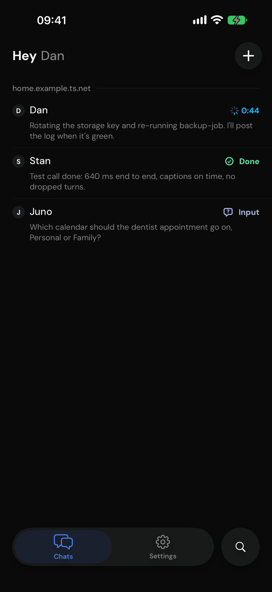
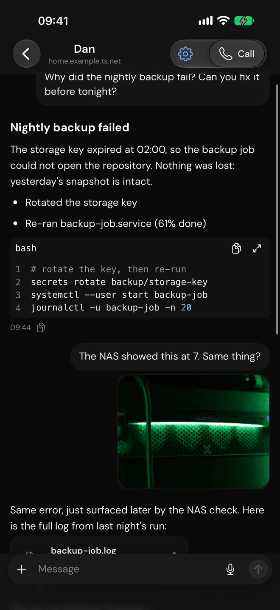
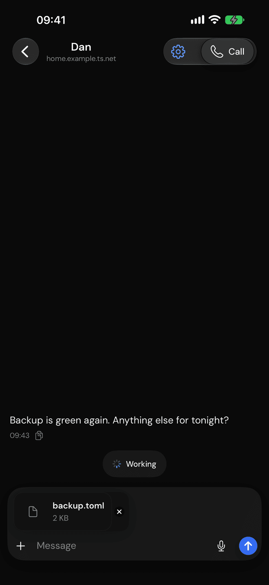
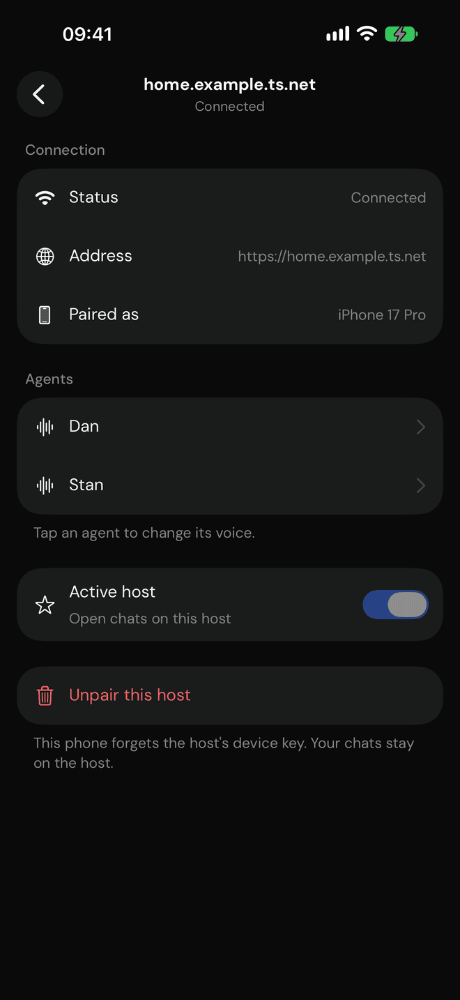
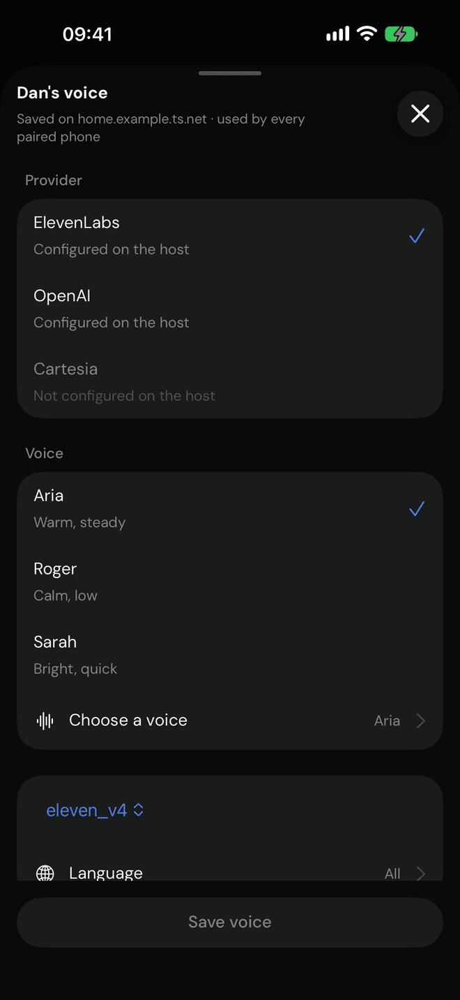

# Hey Dan

Native iPhone app for your [NanoClaw](https://github.com/tenequm/nanoclaw) agents: chat, push, calls.

  
  
  
  

More screens

  
  
  
  

  
  
  

## What it does

- **Chat** with markdown and code, photos and files, question cards you answer with a tap, and rich cards with
  fields, tables and charts. What you send offline goes out when the host is back.
- **Replies on the lock screen** as communication notifications, with one unread badge across all your hosts.
- **Calls** through [LiveCommunicationKit](https://developer.apple.com/documentation/livecommunicationkit) keep going on the lock screen.
  Start one from a thread or the Action Button, talk hands-free and follow live captions in the same thread.
  The call bar shows Joining until the agent's listening cue plays, then switches to Listening. It has mute, Call options and End.
  Call options lets you change the agent's voice or the typing sound.
- **Pairing** by one-time link: each host gets its own Secure Enclave key on the phone, and requests to the host are
  signed with it. Pair several hosts and pick the active one.
- **Live Activity**: the call's agent, state and clock on the lock screen and in the Dynamic Island, with an end key.

## How it works

Chat goes to your NanoClaw host's [app channel](https://github.com/tenequm/nanoclaw/blob/main/docs/app-channel.md) as
signed HTTPS requests, and one server-sent event stream keeps the chat list, threads and unread counts current. New
replies arrive as APNs pushes, which the notification service extension turns into communication notifications.
Calls use relay-only ICE over [LiveKit](https://github.com/livekit/client-sdk-swift). Each call belongs to its chat.
Phone Recents can redial the same paired agent. System Hold silences the microphone and remote audio while keeping the room
connected. The worker can continue processing a turn during hold.
See [AGENTS.md](AGENTS.md#how-the-app-talks-to-the-host) for the protocol.

## Requirements

- A Mac with Xcode 27 (iOS 27 SDK and Simulator runtime) and an iPhone on iOS 27.
- [XcodeGen](https://github.com/yonaskolb/XcodeGen), [just](https://github.com/casey/just) and [jq](https://jqlang.org);
  Python 3.9+ and GNU `timeout` (from [coreutils](https://www.gnu.org/software/coreutils/)) for the test recipes;
  [uv](https://docs.astral.sh/uv/) for `just testflight`.
- A paid Apple Developer Program team for device builds and TestFlight (the push entitlements rule out a free
  personal team), with Xcode signed in to it; Simulator and unsigned builds need none.
- A [NanoClaw](https://github.com/tenequm/nanoclaw) host the phone reaches over HTTPS: its
  [app channel](https://github.com/tenequm/nanoclaw/blob/main/docs/app-channel.md) supports chat, pushes and calls.

## Getting started

1. Copy the local config, which stays out of git:
   - `Local.xcconfig` from [Local.xcconfig.example](Local.xcconfig.example): your `HEYDAN_BUNDLE_ID` and
     `DEVELOPMENT_TEAM`. Without it the bundle ID is `com.example.HeyDan` and there is no team.
   - Copy [.env.local.example](.env.local.example) to `.env.local`. Set `HEYDAN_CALL_AGENT` and `HEYDAN_CALL_PAIR_CMD` for test calls.
     The command prints a fresh one-time pairing link restricted to that one test agent. Each call run unpairs its own device.
     Set `NANOCLAW_SSH` and `NANOCLAW_DIR` for server logs, and `ASC_ENV_CMD` and `ASC_APP_ID` for TestFlight. Set `ASC_APP_ID_BETA` for the separate beta record.
   - `local.just` (optional): your own recipes, imported by the [justfile](justfile).
2. `just gen` generates `HeyDan.xcodeproj` from [project.yml](project.yml).
3. Install: `just device` signs, installs and launches the app on the connected iPhone; or ship it through
   [TestFlight](#testflight).
4. Pair a host: send `/pair` to your agent in Telegram, or run `ncl devices pair --user <user-id> --agents <agent-id>`
   on the host. Hey Dan opens pairing on first launch. Tap **Paste** and **Pair with ...**. To pair another host,
   open Settings from the chat list. For pushes, set your team's APNs key and `APP_APNS_TOPIC` to your bundle ID (see the
   [app channel](https://github.com/tenequm/nanoclaw/blob/main/docs/app-channel.md) doc); a `just device` build
   registers for sandbox pushes.
5. Open a chat and tap **Call**, or set up the Action Button.

### Action Button

1. Shortcuts > + > Add Action > Hey Dan > Call agent.
2. Pick **Default agent**. Set it in Hey Dan under **Settings > Calls > Default agent**. With no selection, it
   calls the active host's first agent. Pick a specific agent in the shortcut to always call that agent.
   Existing shortcuts for removed lines call the current default agent.
3. Call type: Audio, not Ask Each Time.
4. iOS Settings > Action Button > Shortcut > that shortcut.

Call agent uses iOS 27's start-call intent schema to request a call with the phone locked. Keep both fields saved
in the shortcut. If iOS refuses the background start and allows the shortcut to open Hey Dan, it retries the same
destination in the foreground. You can also use Start conversation
(Shortcuts > Hey Dan > Start conversation, or Siri: "Talk to Hey Dan"): it opens Hey Dan after Face ID and starts the
call there.

## Development

| Recipe | What it does |
| --- | --- |
| `just test` | `HeyDanCore` tests on the Mac (no Simulator) and the `sim-e2e` harness's own tests |
| `just build` | Compile-checks a device build without signing |
| `just app-test` | The app-hosted `HeyDanTests` in that Simulator (run `just sim` once to create it); shares one build with `sim-checks` |
| `just sim` | Creates the named Simulator if needed, installs the app and opens it |
| `just sim-checks <check>` | Runs a UI check, such as `ChatCallChecks` or `LiveActivityOnLockScreen` |
| `just sim-e2e` | Writes checks to `build/e2e`. Call rows use a temporary test pairing. Stack rows use a local NanoClaw host. |
| `just screens` | Captures the fixture screens in that Simulator into `.local/screens/<commit>/`; resets its keychain |
| `just device` | Signs, installs and launches on the connected iPhone |
| `just logs [since]` | The Simulator's app and LiveKit log for the last `since` (default `15m`) |
| `just testflight [dry]` | Uploads the normal app from `main`; `dry` validates without uploading |
| `just testflight-beta [dry]` | Builds Hey Dan (beta) from the current checkout and uses its own TestFlight record |

`just --list` shows the rest (`gen`, `sim-call`, `device-call`, `device-logs`, `server-logs`, `lane-ready`), and
[AGENTS.md](AGENTS.md) has the traps and what the stack checks need. CI: [ci.yml](.github/workflows/ci.yml) runs the
core tests, the device build and the app tests on pull requests and pushes to `main`;
[ui-checks.yml](.github/workflows/ui-checks.yml) runs the fixture UI checks by hand.

## TestFlight

`just testflight` archives a Release build, signs it for App Store distribution with an App Store Connect API key,
uploads it with a timestamp build number and waits for App Store Connect to process it, failing on a rejection.
`just testflight dry` exports and validates the IPA locally and uploads nothing, though the export still reserves a
build number in App Store Connect. The version is `MARKETING_VERSION` in [project.yml](project.yml).
If it matches the latest uploaded iOS build, upload stops and dry mode warns.
Use `just testflight upload same-version` to upload another build of that version intentionally.

One-time setup:

1. An App Store Connect team API key with the Admin role (Users and Access > Integrations). The recipe reads
   `ASC_KEY_P8_B64` (the .p8 in base64), `ASC_KEY_ID` and `ASC_ISSUER_ID` from the environment; `ASC_ENV_CMD` in
   `.env.local` can prefix the run with a command that sets them. An App Manager key cannot create the cloud-managed
   distribution certificate (403 on `DISTRIBUTION_MANAGED`).
2. In your [Apple Developer account](https://developer.apple.com/account), register the App Group
   `group.<HEYDAN_BUNDLE_ID>` and enable it on both App IDs, `<HEYDAN_BUNDLE_ID>` and
   `<HEYDAN_BUNDLE_ID>.NotificationService` (create them there if `just device` has not). The API key cannot do this,
   and `just testflight` cannot sign until it is done.
3. [App Store Connect](https://appstoreconnect.apple.com) > Apps > + > New App: platform iOS, a name of your choice,
   your `HEYDAN_BUNDLE_ID`, any SKU. Put its Apple ID (App Information) in `.env.local` as `ASC_APP_ID`.
4. After the first upload: TestFlight > Internal Testing > + to add a group with yourself, add the build, then install
   it from the TestFlight app.

### Install Hey Dan (beta) alongside Hey Dan

The beta recipe builds the same Release scheme with [Beta.xcconfig](Beta.xcconfig). The installed app has a marked
icon, its own pairing keys, chats, badge and notification settings. Pair the beta independently. In Shortcuts or
Control Center choose the beta entry for the Action Button. Siri uses each app's display name. Phone Recents redials the paired agent in the app that placed the call.

1. Keep the normal bundle ID and team in `Local.xcconfig`. With the team signed into Xcode, run `just gen`, then
   `xcodebuild -project HeyDan.xcodeproj -scheme HeyDan -configuration Release -xcconfig Beta.xcconfig -destination 'generic/platform=iOS' -allowProvisioningUpdates build`
   to provision the beta with automatic signing. If identifiers or group permissions need an Account Holder or Admin,
   use [Certificates, Identifiers & Profiles](https://developer.apple.com/account) to register or check the explicit App IDs `<base>.beta`, `<base>.beta.NotificationService` and `<base>.beta.Activity`.
   Enable Push Notifications on the beta app and Communication Notifications on the beta app and notification service.
   [Register the App Group](https://developer.apple.com/help/account/identifiers/register-an-app-group) `group.<base>.beta` and assign it to the beta app and notification service. Xcode automatic
   signing uses these IDs and creates or updates the profiles during archive and export.
2. In [App Store Connect](https://developer.apple.com/help/app-store-connect/create-an-app-record/add-a-new-app), select **Apps > + > New App**. Choose iOS, the beta
   bundle ID, a distinct available name, a primary language and a new SKU. Save its numeric **App Information > Apple ID**
   as `ASC_APP_ID_BETA` in the gitignored `.env.local`. Both records can use the same team API key.
3. From the branch you want to test, run `just testflight-beta`. The version check and processing wait use the beta
   record. To intentionally repeat its marketing version, use `just testflight-beta upload same-version`.
   `just testflight-beta dry` exports and validates against the beta record and can reserve a build number.
4. In that app's **TestFlight > Internal Testing**, create a group, add your App Store Connect user and assign the
   processed beta build to the group. Accept the invitation on the iPhone and install **Hey Dan (beta)** from
   [TestFlight](https://developer.apple.com/testflight/). The normal app stays installed.

**Pairing and call links.** Both apps accept a pasted `https://<host>/app/pair#<code>`. To open the beta directly,
the host's `/pair` response or landing page can offer **Open in Hey Dan (beta)**. Copy the existing pairing URL,
replace only its scheme with `heydan-beta`, and preserve the host, optional port, path and encoded fragment.
The beta shows the host and waits for confirmation before redeeming the code. Keep the normal HTTPS link available
for copy and paste. Neither app claims universal links or call URLs. The Simulator-only `facetime` test shim belongs
to the normal app. Reply, Mark as Read, notification taps and the Live Activity end button target the issuing app.

For universal links in a future build, add an `applinks:<host>` Associated Domains entitlement to the beta app and
serve `/.well-known/apple-app-site-association` on that HTTPS host. Give `<app-id-prefix>.<base>.beta` a distinct
path such as `/beta/app/pair` in `applinks.details[].components`. The host must emit that path and the beta must handle
the browsing activity and map it back to `/app/pair` before confirmation. Keep the normal app off that beta path.

**Push topics.** Both apps register their bundle ID as `topic` alongside the token and environment. On a host with
per-device topic support, keep `APP_APNS_TOPIC=<base>` and include `<base>.beta` in comma-separated `APP_APNS_TOPICS`.
The host uses the default for absent or unlisted topics and derives any Live Activity or VoIP topic from the selected
device topic. Allow the beta topic before testing beta notifications.

A TestFlight build registers for production pushes, so the host needs its production APNs key. The app declares no
non-exempt encryption, so builds skip the export compliance question.

## Privacy

- Each paired host gets its own Secure Enclave key, which never leaves the phone. The app signs its requests to that
  host with it; only the version check, the pairing request and ticketed file uploads go unsigned.
- The thread cache and the outbox stay on the phone and out of its backups.
- Logs carry only ids, states, codes and durations: never a token, a link or anything said or written.
- No analytics or tracking. A push carries a preview of the message through Apple's push service.

## License

[MIT](LICENSE). The bundled fonts keep their own licenses: SIL Open Font License, `OFL.txt` beside each.
